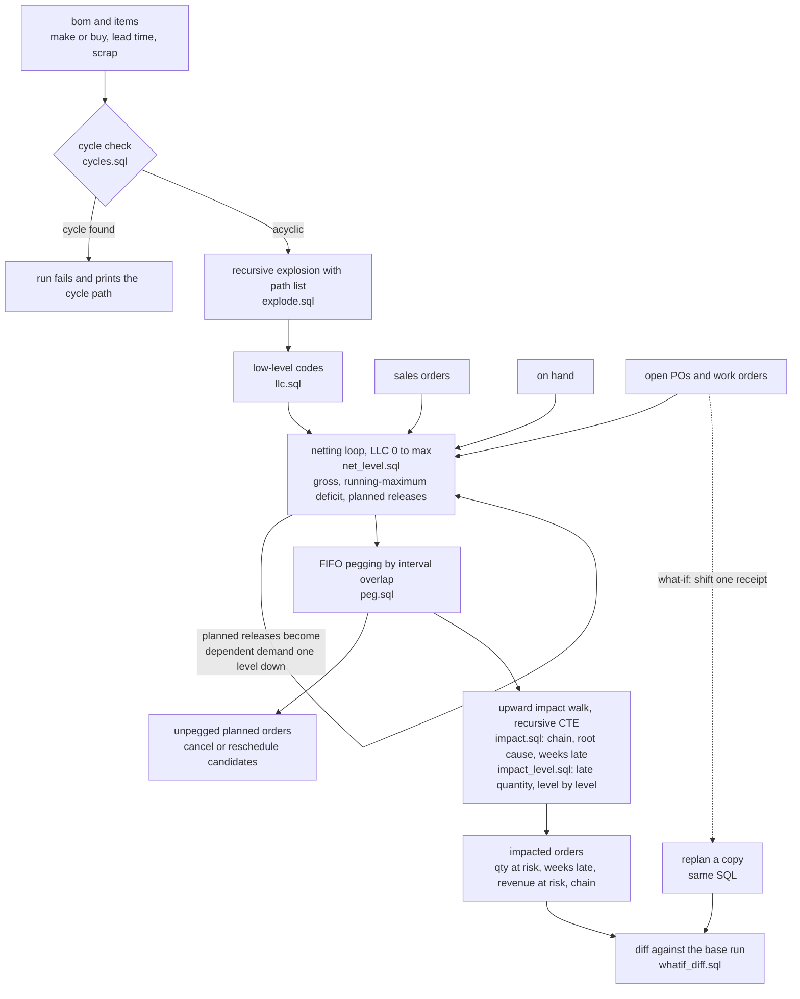

# pegtrace

[](https://github.com/SlateGitOrg/pegtrace/actions/workflows/ci.yml)


pegtrace is a material requirements planning (MRP) engine written in DuckDB SQL. It nets every shared component once, at its low-level code, so stock and open receipts are not counted per bill-of-materials path, and it pegs each shortage up the bill of materials to the customer orders it will make late, with the revenue at risk. A what-if command slips one purchase order, replans a copy and diffs the result. Python generates the data, runs the SQL files in order and provides the CLI; every planning rule lives in `sql/`.

## The problem

A commercial HVAC manufacturer builds rooftop units to order from four-level bills of materials with long-lead purchased parts: compressors, control boards, coils. When a supplier slips a purchase order, MRP produces exception messages per part, but sales needs to know which customer orders move and how much revenue is behind them.

Spreadsheet explosions net stock separately on every BOM path. A control board used directly in the unit and again inside a subassembly has its on-hand counted twice, and the shortage stays hidden until the line stops. Exception messages also stop at the part: nothing connects a late compressor to the sales order number.

The data here is synthetic, produced by a seeded generator (`pegtrace generate`). It has 10 finished goods, 30 subassemblies and 110 purchased components in a four-level BOM, 12 components used at two different levels, 280 sales orders over 26 weekly buckets, 142 open purchase and work orders, and stock for 90 of the 150 items.

## How it works



1. **Cycle check.** `sql/cycles.sql` walks the BOM from every item and returns any cycle as an arrow path. `run` stops with that path.
2. **Explosion and low-level codes.** `sql/explode.sql` explodes every end item with a recursive CTE that carries the path list, so a repeated item is never followed. `sql/llc.sql` takes the maximum depth at which each item appears.
3. **Netting by level.** The runner executes `sql/net_level.sql` for low-level code 0, 1, 2, ... with `SET VARIABLE llc = ...`; the SQL reads it with `getvariable('llc')`. At each level, gross requirements are the sales orders plus dependent demand from the already planned parents (`qty_per / (1 - scrap)`, rounded up, dated at the parent's release week). Cumulative planned receipts are the running maximum of the cumulative deficit, `cum gross - on hand - cum scheduled receipts`, floored at zero, computed with window functions. Planned releases are the receipts offset by the lead time; a release before the as-of week is flagged past due. Requirements dated before the as-of week are netted in the as-of bucket but keep their original need week for lateness.
4. **Pegging.** `sql/peg.sql` lays each item's demand end to end by need week and its supply end to end by availability, and every overlap of the two intervals is a peg row. Availability is the as-of week for on-hand, the due week for a scheduled receipt, and `max(receipt week, as-of week + lead time)` for a planned order. `weeks_late = max(0, availability - need week)`. Planned orders with nothing pegged to them are cancel or reschedule candidates.
5. **Impact.** `sql/impact.sql` starts from the late pegs and walks upward with a recursive CTE: child demand, the parent planned order it belongs to, that order's pegs, until it reaches a sales order. The walk gives the weeks late (the maximum over paths), the root-cause item and the chain. `sql/impact_level.sql` then works out how much is late, from the deepest low-level code up: a demand's late quantity is the sum over its pegs, and a planned order is as late as its worst child demand. `sql/impacted_orders.sql` turns that into quantity and revenue at risk per sales order, pro rata.
6. **Checks.** After every run, each query under `sql/tests/` must return zero rows: pegged quantity equals demand quantity, no supply is pegged beyond its quantity, `LLC(child) > LLC(parent)` on every BOM edge, no negative planned receipts, projected stock never below zero, and impact never exceeds the order.

## Quick start

Python 3.11 or newer.

```bash
python -m venv .venv && source .venv/bin/activate
pip install -e ".[dev]"

pegtrace generate --seed 11 --out data
pegtrace run --data data --db pegtrace.duckdb --as-of-week 1
pegtrace impact --item CB-200 --db pegtrace.duckdb
pegtrace whatif --po PO-0042 --slip 4 --db pegtrace.duckdb
pegtrace report --out report.md --db pegtrace.duckdb
```

`generate --inject-cycle` adds `SUB-A -> SUB-B -> SUB-A`; `run` then exits non-zero and prints that path. `generate` also writes `expected_whatif_impacts.csv`, the orders that slipping PO-0042 to week 10 must make late; the tests compare the what-if result against it.

## Example output

`pegtrace run` on the seed-11 data:

```text
planned as of week 1: 150 items, low-level codes 0..3
planned orders          2220  (23 released past due)
peg rows                5306  (2 planned orders unpegged)
orders made late          49  $2,910,409 of $19,369,360 revenue at risk
invariant queries     all clear
```

`pegtrace whatif --po PO-0042 --slip 4`. Compressor CMP-5T is used only by RTU-5 and RTU-7, has no stock, and PO-0042 (due week 6) exactly covers their orders due in weeks 7 to 10. Slipping it to week 10 makes each of those orders late by `11 - due week`. Nothing else changes, so the table is the whole diff.

```text
PO-0042 (CMP-5T) due week 6 -> 10

sales order  customer                   model  qty at risk  weeks late  revenue at risk  chain
-----------  -------------------------  -----  -----------  ----------  ---------------  --------------------------
SO-1048      Prairie Property Group     RTU-5            9           4         $168,120  SO-1048 <- RTU-5 <- CMP-5T
SO-1049      Atlas Property Group       RTU-7            1           4          $26,880  SO-1049 <- RTU-7 <- CMP-5T
SO-1050      Ridgeline HVAC Supply      RTU-7           12           4         $319,690  SO-1050 <- RTU-7 <- CMP-5T
SO-1060      Granite Mechanical         RTU-5            1           3          $19,120  SO-1060 <- RTU-5 <- CMP-5T
SO-1061      Cedar Mechanical           RTU-5            1           3          $19,360  SO-1061 <- RTU-5 <- CMP-5T
SO-1062      Bluebird Property Group    RTU-5            4           3          $76,160  SO-1062 <- RTU-5 <- CMP-5T
SO-1075      Granite Property Group     RTU-5            1           2          $19,140  SO-1075 <- RTU-5 <- CMP-5T
SO-1076      Copperline Property Group  RTU-5            2           2          $37,150  SO-1076 <- RTU-5 <- CMP-5T
SO-1079      Ridgeline HVAC Supply      RTU-7            2           2          $53,400  SO-1079 <- RTU-7 <- CMP-5T
SO-1084      Ridgeline Mechanical       RTU-5            4           1          $74,080  SO-1084 <- RTU-5 <- CMP-5T
SO-1088      Keystone Property Group    RTU-7            6           1         $154,250  SO-1088 <- RTU-7 <- CMP-5T
SO-1089      Meridian Mechanical        RTU-7           11           1         $291,290  SO-1089 <- RTU-7 <- CMP-5T

12 orders, 54 units, $1,258,640 revenue at risk
```

`pegtrace impact --item CB-200`. Control board CB-200 has 522 on hand and is used by three models directly and inside SUB-COIL-3, 742 in total. Netting once at its low-level code plans 220 units. Netting each usage on its own against the same 522, as a per-path spreadsheet does, plans 0.

```text
No order is late through CB-200.

Netting of CB-200 (low-level code 2, buy, lead time 6 weeks)
  gross requirements        742
  on hand                   522
  open receipts             0
  planned quantity, LLC      220
  planned quantity, per path 0   (4 usages, each netted against the full stock)
```

## Design decisions

- **Lot-for-lot only.** A planned receipt equals the weekly shortfall: no lot sizes, no safety stock, no yield beyond scrap. This keeps netting a closed-form identity (the running maximum of the cumulative deficit) that a window function computes, and the row-by-row check in the tests is exact. The cost is many small planned orders (2,220 in the seed-11 plan); real plants batch.
- **Net once at the low-level code.** Items are processed in order of their deepest appearance, so all demand for an item, from every parent and every BOM depth, is collected before it is netted. The cost is that the BOM must be acyclic, which is why `run` rejects cycles before anything else. The per-path alternative is kept as a baseline in `sql/naive.sql` and is the comparison shown above. A "path" there is a usage: each parent that consumes the item, or customer orders, nets the whole stock separately. Splitting by full path from the end item would net the stock even more times.
- **FIFO pegging on the cumulative-quantity axis.** The earliest need gets the earliest supply, and every peg row is an interval overlap, so quantity is conserved in both directions by construction and asserted in SQL on every run. It is an arithmetic allocation, not a customer-priority rule: two orders due the same week are ordered by id.
- **Lateness is measured against the original need week.** A requirement dated before the as-of week is netted in the as-of bucket, but its lateness still counts from the week it was wanted. A peg that is late only because the parent's release is already past due is not reported as a root cause; the parent's own late peg carries it. Lateness passes up the BOM unchanged, because lead times are already built into the need weeks of every level.
- **Impact is pro rata, summed over supplies, maxed over components.** If 8 of the 16 units a parent order needs are late, half of the parent order is late, and each sales order pegged to it is half at risk, so quantity and revenue at risk can be fractional. When one demand is pegged to several late supplies (a purchase order and a planned order, say), they cover different units, so their late quantities add. Two different components of the same parent cover the same units, so the parent is as late as the worse of them. This needs the late share of every child before its parent is looked at, which is why the quantity step runs level by level instead of inside the recursive walk.
- **Open work orders are treated as kitted.** A scheduled work order creates no dependent demand, because its components are assumed to be issued already. A scheduled receipt due before the as-of week is taken as arriving in the as-of week.

## Testing

```bash
pytest -q
```

100 tests, offline, no warnings. They cover:

- hand-computed fixtures: the textbook plan (planned releases A 20 in week 5 and 40 in week 7, B 20 in week 3 and 80 in week 5, C 170 in week 2 and 40 in week 4; low-level codes 0, 1, 2), the shared-component fixture (20 planned units against 0 for the per-path baseline), scrap (40 units at 5% scrap need 43), as-of handling and FIFO pegging;
- the window-function netting against an independent row-by-row projected-balance loop that lives only in the tests (`tests/reference_mrp.py`), compared per item and week on the seed-11 data with zero mismatches, and again for later as-of weeks and another seed;
- the property that, for every shared component, the horizon-total planned quantity at the low-level code is at least the sum of the per-path shortfalls;
- the impact quantities, including one demand late through several supplies (all 10 units at risk, not the larger supply's 6) and parallel components covering the same units;
- cycle detection, including `run` exiting non-zero with `SUB-A -> SUB-B -> SUB-A`;
- the what-if: `--slip 4` returns exactly the orders in `expected_whatif_impacts.csv` with the expected weeks late, every chain ends at CMP-5T, `--slip 0` gives an empty diff;
- each `sql/tests` query catches the fault it guards against, and returns no rows on the base and what-if runs;
- running `run` twice gives identical tables, and the generator is deterministic for a seed.

## Project layout

```text
sql/
  cycles.sql          cycle paths in the BOM
  explode.sql         recursive explosion with path list and cycle guard
  llc.sql             low-level codes
  init_plan.sql       empty working tables
  net_level.sql       one level of netting, parameterised with SET VARIABLE
  peg.sql             FIFO pegging, unpegged planned orders
  impact.sql          upward walk to sales orders: chain, root cause, weeks late
  impact_level.sql    late quantity of each demand, one low-level code at a time
  impacted_orders.sql per-order quantity and revenue at risk
  naive.sql           per-usage netting baseline for shared items
  whatif_diff.sql     scenario against base
  item_impact.sql     orders late through one item
  item_summary.sql    planning facts for one item
  tests/              invariant queries, each must return zero rows
src/pegtrace/
  bomgen.py           item master and bill of materials
  generator.py        stock, open orders, sales orders, injected patterns
  schema.py           input tables and loaders
  runner.py           runs the SQL in order, cycle and invariant errors
  whatif.py           scenario copy, shift one receipt, replan, diff
  reports.py          text tables and the Markdown report
  cli.py              typer commands
tests/
  reference_mrp.py    independent row-by-row MRP used only by the tests
  test_*.py
```

## License

MIT. See `LICENSE`.
